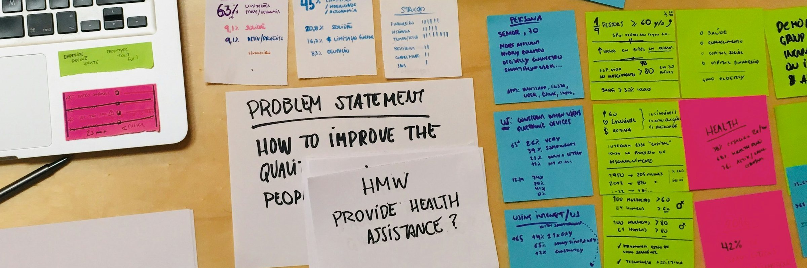
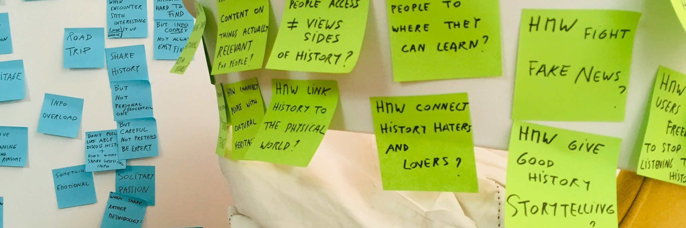
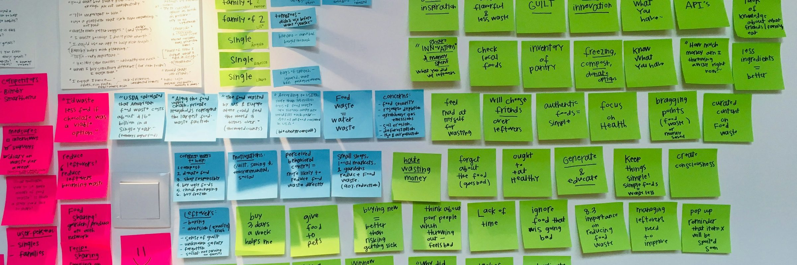

<!-- grav: {"file":"00.courses/course-list.md","site":"https://demo.hibbittsdesign.org/grav-open-course-space"}
title: Courses
visible: false
show_sidebar: false
show_search_box: false
-->

<!-- grav:gen -->
# Courses
<!-- /grav:gen -->

This site is built with **Open Course Space** – an open home on the web for one course or many, each with its own pages, colour and header image, written in plain Markdown files you control.

Here's an example course to explore and build on: **CPT363-1**, organised by modules. Two more examples, CPT363-2 and CPT363-3, show more of what a course can hold – they're switched off; turn on **Published** for each to see them.

<!-- grav:gen -->

<h2><a href="#/cpt363-basic/home">CPT363-1</a></h2>

This is a basic example course, organised by modules, using only a small number of page types and features.

<h2><a href="#/cpt363-intermediate/home">CPT363-2</a></h2>

This is an intermediate example course, organised by modules, using a moderate number of page types and features.

<h2><a href="#/cpt363-advanced/home">CPT363-3</a></h2>

This is an advanced example course, organised by weekly units, using a large number of page types and features.

<!-- /grav:gen -->

<!-- grav:gen -->
<!-- Hides the sidebar on this page -->

<!-- /grav:gen -->
